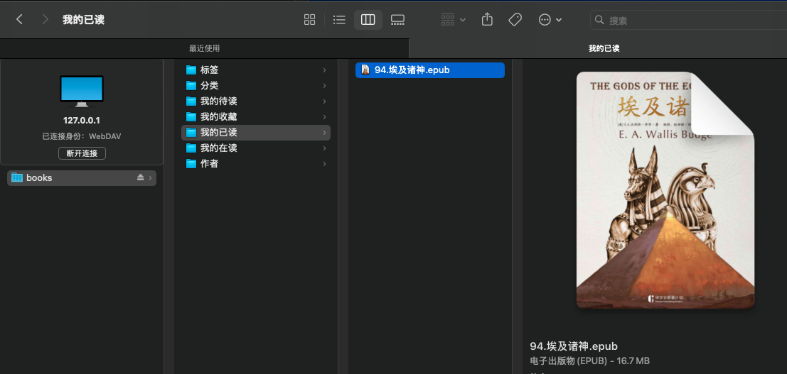
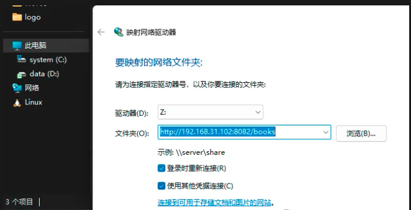

# MyBooks · audiobook 定制版

基于 [PoxenStudio/mybooks](https://github.com/PoxenStudio/mybooks) 的私人图书服务器定制版。
在 Calibre 书库之上提供 Web 阅读、听书、权限分级、元数据刮削、格式转换等能力。

> **当前版本：`4.6.0-build.20`**（上游 tag `4.6.0` + 第 20 次本地构建；P0/P1 稳健性与性能专项已合入）

---

## 文档地图

**只读需要的。** 遇到具体问题再往下翻。

| 我想…… | 看这份 |
|---|---|
| **第一次接触，想知道项目怎么组织、日常怎么干活** | **本文档** |
| 把服务装起来 / 换机器重装 / 排查部署问题 | [`INSTALL_GUIDE.md`](INSTALL_GUIDE.md) |
| 查某个版本改了什么、为什么改 | [`CHANGELOG.md`](CHANGELOG.md) |
| 跟着上游升级、搞清两个操作环境、日常运维套路 | [`docs/操作总纲.md`](docs/操作总纲.md) |
| 部署包含什么、目录怎么摆 | [`docs/部署包说明.md`](docs/部署包说明.md) |
| 改代码（代码结构、测试命令，给人和 AI 看） | [`CLAUDE.md`](CLAUDE.md) |
| 安全问题怎么报 | [`SECURITY.md`](SECURITY.md) |

相对上游的全部代码改动统一记录在 [`CHANGELOG.md`](CHANGELOG.md)。

---

## 和上游的区别

上游 mybooks 是**干净的通用图书服务器**。这份定制版在其上做了四类工作：

| 类别 | 内容 |
|---|---|
| **功能移植** | 阅读器分组分级权限、音频转写（Whisper）、TTS 朗读（edge-tts）、微信读书批注导入 |
| **修上游 bug** | 有声书重复入库、权限判定散落 5 处、同名书误合并、epub 坏字体拖慢打开、阅读统计写库失败 |
| **大量打磨** | 刮削源补清洗、作者名归一化、重复书清理、中文文件名容错、弱网缓存策略 |
| **运维工具** | [`scripts/`](scripts/) 下的原子升级、只改 Python 时的热更、阅读器诊断、自定义内容保护、跟随上游一条龙；另有批量转换与坏字体清扫 CLI |

完整逐条清单见 [`docs/上游跟进清单.md`](docs/上游跟进清单.md)：按 A~F 六节整理，每条都标了上游现状（已修 / 未修）与我们这边的处置和验证方式。

---

## 项目结构

```
audiobook-src/
├── webserver/          Python / Tornado 后端，架在 Calibre 库之上
│   ├── handlers/       HTTP 接口（书籍、阅读器资源、播客、WebDAV…）
│   ├── services/       业务逻辑（转换、刮削、去重、归一化、坏字体处理…）
│   ├── base/           基础设施（格式化、元数据、作者归一化）
│   └── plugins/        元数据刮削源（豆瓣V2 / 百科 / 优书 / 新华 / NeoDB…）
├── app/                Vue 2 + Nuxt + Vuetify 前端（编译为 SPA）
├── myreader-dist/      内嵌阅读器 MyReader 构建产物（Next.js standalone）
├── conf/               nginx / supervisor 配置模板
├── docker/             镜像入口与预置内容
├── tools/              独立脚本（转换器、爬虫、批量维护 CLI）
├── tests/              后端单元测试
├── third-party/        vendored 依赖（foliate-js / edge-tts / epub.js）
└── docs/               细则文档与归档
```

**铁律：源码和数据永远分开。**
数据只在 `/volume1/docker/audiobook-data/`（容器内挂载为 `/data`）。
源码目录 `audiobook/` 里一旦出现 `books/`、`data/`、`library/`、`audios/`，就是出错了——
`scripts/upgrade.sh` 和 `scripts/deploy.sh` 都把这个检查写成硬校验，命中即 `exit 1`。

---

## 快速开始

### 部署（NAS / Linux，推荐）

```sh
# 把 audiobook-deploy-4.6.0-10.tar.gz 放到 /volume1/docker/
tar -xzf audiobook-deploy-4.6.0-10.tar.gz
sh audiobook/scripts/upgrade.sh /volume1/docker/audiobook-deploy-4.6.0-10.tar.gz
```

`scripts/upgrade.sh` 做**原子替换**（`mv audiobook audiobook.old` → 解压到全新目录），
从机制上杜绝旧文件残留，不靠人记得先 `rm -rf`。
构建约 4 分钟，完成后四个进程都应为 `RUNNING`。

首次安装、Windows / 群晖 / 威联通的具体步骤，见 [`INSTALL_GUIDE.md`](INSTALL_GUIDE.md)。

### 本地开发

```sh
# 后端
pip3 install -r requirements.txt
python3 server.py                       # 默认 :8083

# 前端（另开终端）
cd app && npm install && npm run dev     # 默认 :3000，代理到后端

# 检查
pytest tests/                           # 后端全量测试
ruff check webserver/ tools/            # lint（与 CI 一致）
cd app && npm run lint                  # 前端 lint
```

前端改完**必须重新构建**，否则后端服务的还是旧的 `app/dist`：

```sh
cd app && npm run build-spa
```

---

## 版本号规则

当前版本 **`4.6.0-build.20`**，语义是「上游 mybooks 已发布 tag `4.6.0` + 第 20 次本地构建」。
上游 tag 无 `v` 前缀；自己改代码构建号 +1，上游正式发新 tag 后按主题合入再整体改号。

| 标识 | 取值 | 写在哪 / 谁读它 |
|---|---|---|
| **运行期版本**（唯一权威） | `4.6.0-build.20` | `webserver/version.py`（界面与日志显示它）；`docker-compose.yml` 的 `GIT_VERSION`（构建时 Dockerfile 用它覆写 `version.py`）；`app/package.json` / `app/package-lock.json`；`Makefile` 的 `VERSION_LOCK` |
| **上游基线** | mybooks tag `4.6.0`（2026-10-25，commit `3c5947c`） | 只记在本文与 CHANGELOG，用来判断「我们建在哪个上游版本上」 |
| **交付标签 / 包名** | 与运行期版本相同：`4.6.0-build.20` | 包文件名、README、CHANGELOG |

- 只改本地代码 → 构建号 +1（`4.6.0-build.21`），上游段不动；
- 上游**正式发布 tag** 后按主题合入 → 整体改号（如 `4.6.1-build.20`），构建号仍从 20 起；
- 上游 `develop` 上虽已是 `4.6.1`，但**没有 tag、没有 Release 就不跟号**，避免与上游未来正式发布的内容脱节。

### 旧 `4.8.x` 号段已封存

`v4.7.1 ~ v4.8.x` 全部封存，与 `4.6.0-build.20` **没有任何版本先后关系**——这是**号段重置**，
因为「新程序」的第一版要从上游已发布 tag 起算。旧 `v4.8.2` / `v4.8.3` 对应 `4.6.0-1`，
`4.6.0-2` 之后构建号连续、无需换算；完整对照表见 [CHANGELOG 开头的「号段重置说明」](CHANGELOG.md)。

### 四条不要搞错的事

1. **整串排序低于 `4.6.0`，不能拿来和 `4.6.0` 比大小。** `-build.20` 是 semver 的预发布标记
   （prerelease），`4.6.0-build.20 < 4.6.0`。本程序不发布 npm 包、`app/package.json` 无 `engines`
   校验，所以这个排序差异没有实际影响；这么写是为了让「建在上游哪个 tag 上」一眼可见。
2. **同一上游基线的本地构建之间，只能靠 `build.N` 区分。** `>` 比较整体版本会漏判
   （`4.6.0-build.21` 与 `4.6.0-build.20` 的主版本段相同），要比较就单独取出 `build.N` 数值段。
   本仓库现有的版本展示/比对都是一次性字符串比较（`main.py`、`handlers/admin.py`），没有排序比较逻辑。
3. **该写法同时是合法 Docker tag**（字符集 `[A-Za-z0-9_.-]`），可以直接用进镜像 tag，
   不需要为 `+` 或其它字符做转义。
4. **版本号是锁死的，不是随手改的字符串。** `scripts/check-version-lock.py` 可独立执行
   （`python3 scripts/check-version-lock.py`），`tests/test_version_lock.py` 有 9 个用例（1 个正向 + 8 个负向），
   `scripts/pack.sh` 打包前也会强制跑一遍；Dockerfile 遇到空 `GIT_VERSION` 直接 `exit 1`，
   Makefile 遇到不一致的 `VER` 直接 `$(error)`。写回 `v4.8.x`、写成裸 `4.6.0`、留空、
   删掉任意一处守卫，都会**构建/测试失败**（这是防版本回退 / 防被交付标签覆盖的保护，
   不是普通测试失败；失败信息里会给出补救方法）。

---

## 发布流程

```
开发侧改代码 → git commit → 出包 → 推 Gitee → NAS 上 scripts/upgrade.sh 上线
```

完整步骤、两个操作环境的区别、跟上上游的合并套路，见 [`docs/操作总纲.md`](docs/操作总纲.md)。

---

## 上游项目介绍

以下是上游 MyBooks 的原版说明，功能描述同样适用于本定制版。

本项目专注于个人及家庭私有电子书、实体书管理，以及多账号的阅读管理，不适用于站点搭建。
后续目标是结合 AI 提供更多的扩展阅读内容，形成个人的知识库。

本系统与电子书阅读器不同，主要功能在于对电子书的管理功能。
阅读器可以灵活选择，欢迎使用与 MyBooks 深度绑定的 [MyReader](https://github.com/PoxenStudio/myreader)。

**友情提醒：中国境内网站，个人是不允许进行在线出版的，维护公开的书籍网站是违法违规的行为！建议仅作为个人使用！**

### 项目介绍

MyBooks 特性包括：

* 支持阅读数据统计与展示
* 支持用户书单创建与分享
* 通过工具箱提供丰富的书籍管理工具
* 支持 WAP 简版页面，供精简浏览器访问
* 支持监听导入目录并自动导入新书
* 支持提供 Podcast 服务，让书库变播客
* 支持以 WebDAV 连接及数据同步
* 支持推送到支持 Wifi 传书的设备及 Kindle 上
* 支持自定义分类
* 支持添加实体书
* 支持阅读管理
* 集成 epub2audio 将 epub 转换有声书，内置多个中文及英文声音
* 更新 Calibre 7.6，系统使用 Ubuntu 24.04
* 支持中文搜索时，使用简繁体同时搜索
* 支持 epub、azw3、pdf 互转，支持 Word 文档入库
* 支持将图书指定为私藏模式，仅有上传者可见
* UI 风格美化 —— 增加暗黑模式
* 支持切换不同图标，支持设置用户头像
* 阅读器支持颜色样式切换，字体切换（提供 4 个内置字体）

扩展工具：

* Chromium 系列浏览器（Chrome / Edge）扩展，快速查询与上传电子书：
  [MyBooks Browser Extension](https://github.com/poxenstudio/extensions)
* AI 工具集成：[MyBooks Skill](https://clawhub.ai/poxenstudio/mybooks)（原 Talebook Skill）
* KoReader 插件：[mybooks-koreader-plugin](https://github.com/PoxenStudio/mybooks-koreader-plugin)

---

> 以下使用说明（Docker / Windows / WebDAV / MCP / Skill / FAQ）沿用上游原文。

## Docker

> **本包是从源码构建的移植版**，请用下面「从源码构建」的方式启动。
> 直接 `docker run poxenstudio/mybooks` 拉的是官方镜像，**不含** v4.7 的读者组/音频转写等改动。

### 从源码构建（推荐，本包必须用这个）

`docker-compose.yml` 已配好 `build:` + `image:`，两条命令即可：

```bash
docker compose up -d --build      # 首次构建约 5～15 分钟
docker compose logs -f mybooks    # 看启动日志
```

**嫌慢？用带缓存的构建方式**（改代码后重建通常 1 分钟内）：

```bash
make fast-build     # 构建（BuildKit + 本地层缓存）
make fast-up        # 构建并启动
make clean-cache    # 缓存出问题时清掉
```

> 首次构建慢主要是因为要拉 ~1.5GB 的 `mybooks_base`（Ubuntu+Calibre+FFmpeg），
> 属正常现象；之后都会命中缓存。**不要随手 `--no-cache`**，那等于每次从头来。

要点：

* `build: .` 表示用当前目录源码构建；`image: mybooks-local:latest` 只是给本地构建出的镜像打的标签。
  **只写 `image:` 而不写 `build:` 会导致只拉远程镜像、忽略本地改动。**
* 前端由 Dockerfile 内多阶段构建自动完成（`npm ci` + `npm run build-spa`），本地无需装 Node。
* `app/package.json` 的 `nuxt` 必须保持在 `^2.18.x`（本项目是 Nuxt 2 + Vue 2）。
  误写成 `^4.x` 会装成 Nuxt 4 / Vue 3，构建时报
  `<template v-for> key should be placed on the <template> tag` 之类的错误。
* Dockerfile 用 `npm ci` 严格按 `package-lock.json` 安装，杜绝版本漂移。
* `app/.npmrc` 已指向 npmmirror 国内源；构建时传入 `BUILD_COUNTRY=CN` 可同时启用 apt/pip 国内源（compose 已默认传入）。

### 使用官方镜像

镜像地址：[dockerhub](https://hub.docker.com/r/poxenstudio/mybooks)
* 已经调整基于```Ubuntu 24.04```和```Calibre 7.6```构建, 改善兼容性。Docker运行的UID/GID不要设置为```root```(ID:0)。

若只想跑官方发布版，可下载仓库中的配置文件[docker-compose.yml](docker-compose.yml)，执行：

```
wget https://raw.githubusercontent.com/PoxenStudio/mybooks/master/docker-compose.yml
docker-compose -f docker-compose.yml  up -d
```

如果使用原生docker，那么执行命令：
`docker run -d --name mybooks -p <本机端口>:80 -v <本机data目录>:/data poxenstudio/mybooks`


例如
`docker run -d --name mybooks -p 8080:80 -v /tmp/demo:/data poxenstudio/mybooks`

## Windows使用说明

> 自 v4.6 起已**彻底移除 Windows 独立安装器（exe）**，Docker 是唯一官方部署方式。

Windows 用户请先安装 [Docker Desktop](https://www.docker.com/products/docker-desktop/)，
把本项目解压到某个目录（如 `D:\mybooks`），在 PowerShell 里执行：

```powershell
cd D:\mybooks
docker compose up -d --build
```

启动后浏览器访问 `http://localhost:8080`。数据目录即 docker-compose.yml 中挂载的本地目录（默认 `./data`），可直接查看与备份。

> 注意不要单独执行 `docker compose up -d`（不带 `--build`）就在源码目录里跑：
> 若本地还没有构建过镜像，Compose 会去拉同名远程镜像。

## 使用WebDAV连接
WebDAV URL地址: `http://<ip or domain>:<port>/books`
* macOS下
在`连接到服务器`输入对应的URL进行连接:


* Windows下
如果未配置https, 需要先将WebClient修改为支持HTTP协议：
```
1. 打开注册表, (运行->输入regedit)
2. 找到 HKEY_LOCAL_MACHINE\SYSTEM\CurrentControlSet\Services\WebClient\Parameters, 将BasicAuthLevel改为2
3. 以超级管理员身份运行PowerShell, 先入输入net stop webclient 和 net start webclient.
```
然后通过`映射网络驱动器`连接到指定URL：

访问列表:


## 使用MCP Service
从v3.15.0开始，支持MCP服务，可以集成到AI工具中使用。现在使用流程会提示提供账号信息进行登录，然后才能正常使用。
```
{
  "mcpServers": {
    "talebook": {
      "type": "streamableHttp",
      "url": "http://<ip>:<port>/api/mcp/stream",
      "description": "Local ebooks management system"
    }
  }
}
```

## 使用Skill操作书库
详情见[MyBooks Skill](https://clawhub.ai/poxenstudio/mybooks)。
旧的[Talebook Skill](https://clawhub.ai/poxenstudio/talebook)。

## 自定义工具扩展书库功能
详情见[开发 MyBooks 工具](https://mybookstop.github.io/docs/manual/tool-development)。

## 常见问题

常见问题请参阅[使用指南](document/UserGuide.zh_CN.md)，无法解决的话，提个ISSUE, 或进入公众号私信。

手动安装请参考[开发者指南](document/Development.zh_CN.md)

**再次声明！本项目没有维护任何公开的书库站点。**


## 贡献者
[](https://github.com/PoxenStudio/mybooks/graphs/contributors)


## 项目首页
[PoxenStudio MyBooks](https://mybooks.top)

## 联系邮箱
📧 [poxenstudio@gmail.com](mailto:poxenstudio@gmail.com)
