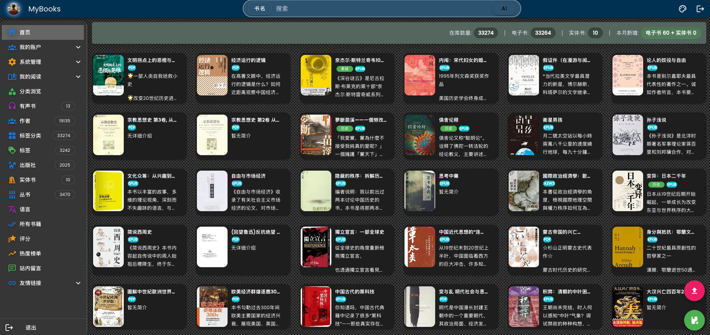
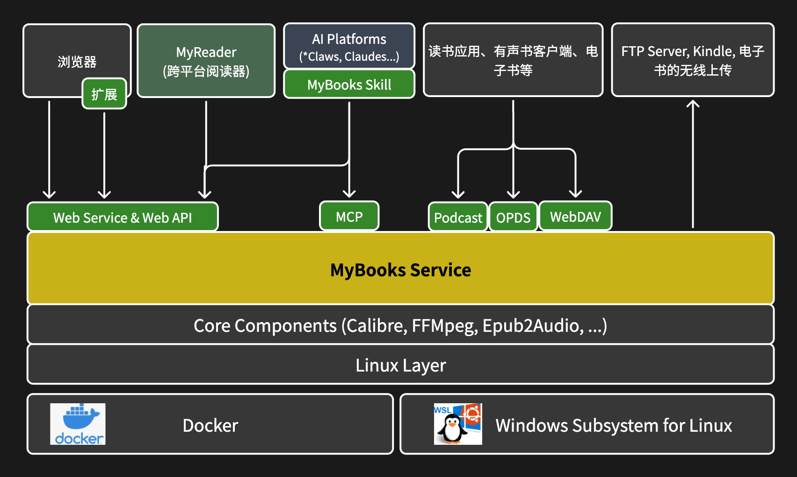
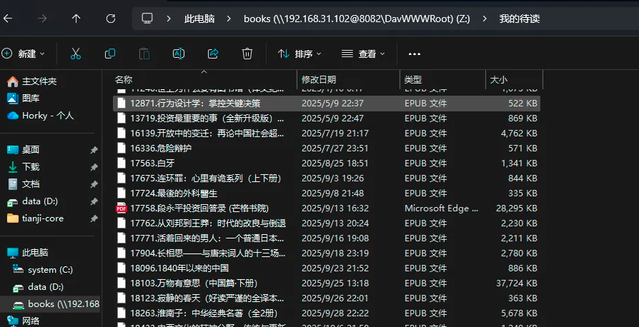

# MyBooks: Personal Calibre WebServer
[](https://github.com/poxenstudio/mybooks/blob/master/LICENSE)
[](https://hub.docker.com/r/poxenstudio/mybooks)


An enhanced personal books management webserver built on Calibre + Vue, beautiful and easy-to-use. ([English](document/README.en.md))

## 简单好用的个人图书管理系统
本项目专注于个人及家庭私有电子书、实体书管理，以及多账号的阅读管理，不适用于站点搭建。后续目标是结合AI提供更多的扩展阅读内容，形成个人的知识库。


本系统与电子书阅读器不同，主要功能在于对电子书的管理功能。阅读器可以灵活选择，欢迎使用与MyBooks深度绑定的[MyReader](https://github.com/PoxenStudio/myreader)。

**友情提醒：中国境内网站，个人是不允许进行在线出版的，维护公开的书籍网站是违法违规的行为！建议仅作为个人使用！**

### 项目介绍
MyBooks特性包括:
* 支持阅读数据统计与展示
* 支持用户书单创建与分享
* 通过工具箱提供丰富的书籍管理工具
* 支持WAP简版页面，供精简浏览器访问
* 支持监听导入目录并自动导入新书
* 支持提供Podcast服务，让书库变播客
* 支持以WebDAV连接及数据同步
* 支持推送到支持Wifi传书的设备及Kindle上
* 支持自定义分类
* 支持添加实体书
* 支持阅读管理
* 集成epub2audio将epub转换有声书，内置多个中文及英文声音。
* 更新Calibre 7.6，系统使用Ubuntu 24.04
* 支持中文搜索时，使用简繁体同时搜索
* 支持epub、azw3、pdf互转, 支持Word文档入库
* 支持将图书指定为私藏模式，仅有上传者可见
* UI风格美化 - 增加暗黑模式
* 支持切换不同图标，支持设置用户头像
* 阅读器支持颜色样式切换，字体切换(提供4个内置字体)

扩展工具：
* 在Chromium系列浏览器，包括Chrome和Edge中安装扩展，可以快速方便进行查询和电子书上传，详情见[MyBooks Browser Extension](https://github.com/poxenstudio/extensions)。
* 在AI工具，如OpenClaw、QClaw中集成[MyBooks Skill](https://clawhub.ai/poxenstudio/mybooks)[之前为Talebook Skill]。
* KoReader插件：[mybooks-koreader-plugin](https://github.com/PoxenStudio/mybooks-koreader-plugin)


目前提供的能力如下：



### 致谢
我们自2025年6月开始基于[talebook v25.06.26](https://github.com/talebook/talebook)开发，感谢Rex等几位朋友贡献的优秀项目和前后端框架，也要感谢Calibre项目提供了强大的电子书管理的核心功能。本项目仍然会坚持开源免费, 遵循项目的开源协议，期望能持续成为书友们的好帮手。


### Web API
[Web API文档](document/WebAPI.md)

### 关注项目
公众号```Talebook```


## v4.8.0 音频转写可用 + 读者组易用性 + 有声书挂靠 + 内嵌阅读器

**内嵌阅读器 MyReader（修 `/readerx` 502）**

* 之前 `/readerx/open?bookId=…&format=…` 一直 **502 Bad Gateway**：`myreader-dist/` 里
  只有 `.keep` 占位，容器里 `/var/www/myreader/app/server.js` 不存在 → supervisor 起不来 →
  9100 不监听 → nginx upstream 拒绝连接。**现在源码包内直接附带构建好的产物**
  （92MB / 2605 文件），开箱即用。
* MyReader 的 GitHub Release 里只有 `.deb` / `.dmg` / `.apk` / `.exe` 这些桌面和移动安装包，
  **没有**容器可用的 web 产物，所以是从 `PoxenStudio/MyReader` tag `0.9.1` 源码构建的
  （`pnpm build-docker-dist`），构建步骤见 `INSTALL_GUIDE.md` 第八节。
* 修掉一个很隐蔽的坑：`.dockerignore` 里的 `**/node_modules`（给前端源码用的）会把
  `myreader-dist` 下**三层**产物依赖一起排掉。其中 `app/.next/node_modules/` 那层被排掉时，
  服务能正常启动、9100 也能监听，但**第一个请求才报** `Cannot find module 'js-md5-<hash>'`。
  已加显式放行，并用真实 `docker build` + 起容器实测过（`/readerx/...` 返 200）。
* 实测数据：`pnpm install --frozen-lockfile` 21.8s，`next build` 35s，产物 92MB。

**音频转写（Whisper）**

* **镜像内置 `faster-whisper`**（构建参数 `WITH_WHISPER=1`，默认开）。不装 torch，约 +250MB，
  比 openai-whisper 快 4 倍以上。不需要就把参数设成 `0`。
* **转写同时产出 `.srt` + `.txt`**：`.srt` 带时间轴，播放页会自动配对同名字幕文件，
  **播放时逐句高亮跟随**；`.txt` 是纯文本全稿，用于搜索/复制/离线阅读。
* **模型下载走 `hf-mirror.com`**（`HF_ENDPOINT`），并关闭 xet 通道（`HF_HUB_DISABLE_XET=1`）——
  国内直连 huggingface.co 基本不通，原实现会卡死。
* **模型缓存在 `/data/models/whisper`**，容器重建不用重下。`TRANSCRIBE_MODEL` /
  `TRANSCRIBE_LANG` / `TRANSCRIBE_KEEP_TXT` 可在设置里调。
* 锁定 `av<16`：faster-whisper 1.2.x 仍调 `av.open(metadata_errors=...)`，av 16+ 删了该参数会
  `TypeError`。运行期也加了版本守卫，报错信息直接给出修复命令。

**读者组**

* **分类/标签从「手打文本框」改成下拉多选**（`v-combobox multiple`）：候选值来自系统里
  真实存在的分类与标签（新增接口 `/api/admin/reader_groups/options`），点选即可，
  仍允许自由输入。以前打错一个字符就静默失效（白名单看不到任何书、黑名单什么都没屏蔽）。
* 组列表里的分类/标签以 chips 呈现，重复值自动去重。

**有声书挂靠（修上游 bug）**

* **后加音频不再变成另一本书**。电子书在 `library/`、有声书在 `audios/<book_id>/`，两套目录。
  上游导入音频时只看「这本书有没有 `audios/<id>/`」，没有就新建一本书——于是先导 epub、
  后加音频，书库里就多出一条同名记录。
* 现在发现**同名书籍已存在**就复用它的 `book_id`（挑选优先级：`library/` 里真有格式文件的那本 →
  都没有则取最早的 id），音频仍放 `audios/<book_id>/`。一条记录、一个封面、一套元数据。
* 新增设置项 **`AUDIO_LINK_TO_EXISTING_BOOK`**（默认开），后台「系统设置 → 阅读与浏览 →
  有声书导入」可关；关掉恢复旧行为。扫描结果多一项「已挂靠」计数，日志打
  `[AUDIO_IMPORT] 同名书籍已存在(book_id=N)，音频将挂到该书而非新建`。
* 注意：本改动只影响之后的导入，**历史重复记录用内置的「重复书清理」一次合并**（见下）。

**同名重复书清理（迁移工具）**

* 后台「管理 → 重复书清理」（`/toolbox/book_dedup`）：先**扫描预览**（只读），
  看清每组的"保留/删除"关系后再一键合并。不用连 SSH、不用一条条手点。
* 合并时自动完成：音频目录 `audios/<重复id>/` → `audios/<保留id>/`（封面、`.srt` 字幕
  一起搬，不覆盖目标已有文件）→ 阅读进度/收藏/书单/评论/分享**改指**到保留书 →
  删掉重复记录 → 修正 `ScanFile` 指向。
* **三条安全线**：① 方向不明确的组（两本都有电子书、都没有电子书、同名超 8 本）
  只报告不改动；② 执行前用 `sqlite3.backup()` 在线备份用户库到 `data/backup/`；
  ③ 删 calibre 记录前再校验一次"确实没有电子书格式"，有就拒删。
* 书单关联的冗余行被删时会同步扣减 `book_count`，避免书单显示数量虚高；
  共读同步记录（`book_records`，身份是 `book_hash`）删而不改指，否则 hash 与 id 会串书。

**工程**

* 新增 `PORTING_NOTES.md`：全部改动清单、上游更新合并指引、冲突解决速查、隐性耦合点。
* 测试：`test_transcribe_service.py` 24 项（双后端 + SRT 格式 + 边界）、
  `test_reader_group.py` 14 项（含 options 接口容错）、`test_audio_link_existing.py` 17 项
  （开关解析 / 挂靠挑选 / 状态计数）、`test_book_dedup.py` 43 项（含真实 SQLite 库的
  关联数据迁移验证），合计 98 项全通过。

## v4.7.4 修复

* **`COPY myreader-dist*` 报 "no source files were specified"**：Docker 的 COPY 通配符零匹配会直接报错（不是静默跳过）。
  改为内置 `myreader-dist/.keep` 占位文件 + `COPY myreader-dist/`，始终有源可拷。
  自 v4.8.0 起源码包已附带真实产物，这个问题不会再出现。


## v4.7.3 修复与加速

**修复（都是会让构建直接失败/异常的硬问题）**

* **`third-party/*` 是空的 git submodule**：`COPY` 空目录会失败。改为「有就拷、空则警告并继续」。
  * `foliate-js` 缺失 → 仅微信读书批注导入(CFI 生成)不可用，其他功能不受影响。
  * `edge-tts` 缺失 → 自动回退 PyPI 官方版。注意官方版 `list_voices` 不支持 `proxy` 参数，
    代理环境下听书可能异常；需要完整功能请 `git submodule update --init third-party/edge-tts`。

**加速**

* `.dockerignore` 重写：排除 `node_modules`/`.nuxt`/`dist`/`__pycache__`/`.DS_Store` 等，
  以及前端专用的大体积库（`third-party/epubreader-js` 35M 等），构建上下文更小、传输更快。
* `docker-compose.yml` 加 `target: production`，跳过 test 阶段（省一次完整 pip install）。
* 新增 **`make fast-build` / `make fast-up`**：BuildKit + 本地层缓存（`.buildcache`），
  改代码后重建通常 1 分钟内完成；`make clean-cache` 清缓存。
* `cfi_gen` 的 `npm ci` 补上国内源（原来没走镜像，国内很慢）。

**关于 `mybooks_base`（慢的主因）**

基础镜像约 **1.5 GB**（Ubuntu 24.04 + Calibre 7.6 + FFmpeg + Node），首次构建必须拉取。
之后会命中本地缓存。国内建议给 Docker 配 `registry-mirrors`（`docker.1ms.run`、
`docker.m.daocloud.io`、`hub.rat.dev` 实测均可用）。

## v4.7.2 修复（Node 版本过低）

* **builder 阶段基础镜像 `node:16-alpine` → `node:20-alpine`**。Nuxt 2 的 CLI 链里 `@clack/core` 用了
  `node:util` 的 `styleText`（Node ≥ 20.12 才有），Node 16 下 `import` 阶段直接失败：
  ```
  import { styleText } from 'node:util';
  SyntaxError: The requested module 'node:util' does not provide an export named 'styleText'
    at file:///build/node_modules/@nuxt/cli/bin/nuxi.mjs:78:21
  ```
  注意 ESLint 那步是通过的（`0 errors`），报错发生在真正开始构建时，很容易误判。
* Dockerfile 里加了 Node 主版本断言，低于 20 时构建直接给出明确提示，而不是含糊的模块错误。
* 实测：Node 16.20.2 的 `util.styleText === undefined`；Node 20.19.0 下 `npm ci`（5 秒）+
  `npm run build-spa`（36 秒 `Compiled successfully`）全部通过。

## v4.7.1 修复（构建问题）

* **`app/package.json` 的 `nuxt` 版本写错**：原为 `^4.6.2`（会解析到 Nuxt 4 / Vue 3），本项目是 Nuxt 2 + Vue 2，导致
  `npm install` 拉一整套 Nuxt 4 依赖后编译报 `<template v-for> key should be placed on the <template> tag`。
  已改为 `^2.18.1`，与 `package-lock.json` 里锁定的 2.18.1 一致。
* **Dockerfile 改用 `npm ci`**：严格按 lockfile 安装，杜绝 `^` 范围重新解析出不兼容大版本。
* **20 处 `<template v-for>` 的 `:key` 统一移到 `<template>` 标签上**：Vue 3 编译器强制此规则，
  这样即便将来依赖解析异常也不会因此直接构建失败。
* **新增 `app/.npmrc`**（npmmirror 源），`docker-compose.yml` 默认传 `BUILD_COUNTRY: CN`，构建更快。
* 实测结果：`npm ci` 5 秒装完 1448 个包 → `npm run build-spa` 36 秒 `Compiled successfully`，ESLint 0 error。

## v4.7 新增（移植自 audiobook 项目）

* **读者组分级权限**：管理员定义读者组（白名单/黑名单 + 分类/标签），用户划入组即可批量限制可读书目，不用逐个设置。
  API：`GET/POST /api/admin/reader_groups`、`POST /api/admin/reader_groups/delete`、`POST /api/admin/reader_groups/assign`（管理员）。
  生效规则：用户自己显式设置过阅读范围就用自己；否则回退组配置。组定义持久化在站点设置（`READER_GROUPS`），用户归属存在用户 `extra.reader_group`，零数据库迁移。
* **音频转写文稿（可选）**：Whisper 把有声书音频转成可阅读的 .txt 文稿。
  服务器需 `pip install -r requirements-optional.txt`（含 openai-whisper/torch，体积大故不进主依赖）；
  未安装时 `GET /api/admin/transcribe/available` 返回 `{"available": false}`，前端可隐藏入口。
  API：`POST /api/admin/transcribe/run|cancel`、`GET /api/admin/transcribe/status`。转写进度接入既有后台任务体系。
  路径支持文件或目录（目录自动递归收集音频），前端带服务器目录浏览器（复用服务端目录浏览，范围限 /data）。

> Windows 安装器（exe）自 v4.6 起已彻底移除，Docker 是唯一官方部署方式，见下节。

## Docker

> **本包是从源码构建的移植版**，请用下面「从源码构建」的方式启动。
> 直接 `docker run poxenstudio/mybooks` 拉的是官方镜像，**不含** v4.7 的读者组/音频转写等改动。

### 从源码构建（推荐，本包必须用这个）

`docker-compose.yml` 已配好 `build:` + `image:`，两条命令即可：

```bash
docker compose up -d --build      # 首次构建约 5～15 分钟
docker compose logs -f mybooks    # 看启动日志
```

**嫌慢？用带缓存的构建方式**（改代码后重建通常 1 分钟内）：

```bash
make fast-build     # 构建（BuildKit + 本地层缓存）
make fast-up        # 构建并启动
make clean-cache    # 缓存出问题时清掉
```

> 首次构建慢主要是因为要拉 ~1.5GB 的 `mybooks_base`（Ubuntu+Calibre+FFmpeg），
> 属正常现象；之后都会命中缓存。**不要随手 `--no-cache`**，那等于每次从头来。

要点：

* `build: .` 表示用当前目录源码构建；`image: mybooks-local:latest` 只是给本地构建出的镜像打的标签。
  **只写 `image:` 而不写 `build:` 会导致只拉远程镜像、忽略本地改动。**
* 前端由 Dockerfile 内多阶段构建自动完成（`npm ci` + `npm run build-spa`），本地无需装 Node。
* `app/package.json` 的 `nuxt` 必须保持在 `^2.18.x`（本项目是 Nuxt 2 + Vue 2）。
  误写成 `^4.x` 会装成 Nuxt 4 / Vue 3，构建时报
  `<template v-for> key should be placed on the <template> tag` 之类的错误。
* Dockerfile 用 `npm ci` 严格按 `package-lock.json` 安装，杜绝版本漂移。
* `app/.npmrc` 已指向 npmmirror 国内源；构建时传入 `BUILD_COUNTRY=CN` 可同时启用 apt/pip 国内源（compose 已默认传入）。

### 使用官方镜像

镜像地址：[dockerhub](https://hub.docker.com/r/poxenstudio/mybooks)
* 已经调整基于```Ubuntu 24.04```和```Calibre 7.6```构建, 改善兼容性。Docker运行的UID/GID不要设置为```root```(ID:0)。

若只想跑官方发布版，可下载仓库中的配置文件[docker-compose.yml](docker-compose.yml)，执行：

```
wget https://raw.githubusercontent.com/PoxenStudio/mybooks/master/docker-compose.yml
docker-compose -f docker-compose.yml  up -d
```

如果使用原生docker，那么执行命令：
`docker run -d --name mybooks -p <本机端口>:80 -v <本机data目录>:/data poxenstudio/mybooks`


例如
`docker run -d --name mybooks -p 8080:80 -v /tmp/demo:/data poxenstudio/mybooks`

## Windows使用说明

> 自 v4.6 起已**彻底移除 Windows 独立安装器（exe）**，Docker 是唯一官方部署方式。

Windows 用户请先安装 [Docker Desktop](https://www.docker.com/products/docker-desktop/)，
把本项目解压到某个目录（如 `D:\mybooks`），在 PowerShell 里执行：

```powershell
cd D:\mybooks
docker compose up -d --build
```

启动后浏览器访问 `http://localhost:8080`。数据目录即 docker-compose.yml 中挂载的本地目录（默认 `./data`），可直接查看与备份。

> 注意不要单独执行 `docker compose up -d`（不带 `--build`）就在源码目录里跑：
> 若本地还没有构建过镜像，Compose 会去拉同名远程镜像。

## 使用WebDAV连接
WebDAV URL地址: `http://<ip or domain>:<port>/books`
* macOS下
在`连接到服务器`输入对应的URL进行连接:


* Windows下
如果未配置https, 需要先将WebClient修改为支持HTTP协议：
```
1. 打开注册表, (运行->输入regedit)
2. 找到 HKEY_LOCAL_MACHINE\SYSTEM\CurrentControlSet\Services\WebClient\Parameters, 将BasicAuthLevel改为2
3. 以超级管理员身份运行PowerShell, 先入输入net stop webclient 和 net start webclient.
```
然后通过`映射网络驱动器`连接到指定URL：

访问列表:


## 使用MCP Service
从v3.15.0开始，支持MCP服务，可以集成到AI工具中使用。现在使用流程会提示提供账号信息进行登录，然后才能正常使用。
```
{
  "mcpServers": {
    "talebook": {
      "type": "streamableHttp",
      "url": "http://<ip>:<port>/api/mcp/stream",
      "description": "Local ebooks management system"
    }
  }
}
```

## 使用Skill操作书库
详情见[MyBooks Skill](https://clawhub.ai/poxenstudio/mybooks)。
旧的[Talebook Skill](https://clawhub.ai/poxenstudio/talebook)。

## 自定义工具扩展书库功能
详情见[开发 MyBooks 工具](https://mybookstop.github.io/docs/manual/tool-development)。

## 常见问题

常见问题请参阅[使用指南](document/UserGuide.zh_CN.md)，无法解决的话，提个ISSUE, 或进入公众号私信。

手动安装请参考[开发者指南](document/Development.zh_CN.md)

**再次声明！本项目没有维护任何公开的书库站点。**


## 贡献者
[](https://github.com/PoxenStudio/mybooks/graphs/contributors)


## 项目首页
[PoxenStudio MyBooks](https://mybooks.top)

## 联系邮箱
📧 [poxenstudio@gmail.com](mailto:poxenstudio@gmail.com)
